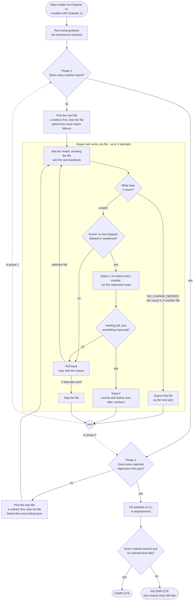

# Upshift

**An autonomous migration agent that finishes what the official codemod can't.**

Point it at a Python repo stuck on Pydantic v1. It runs `bump-pydantic`, then
lets the interpreter tell it what is still broken, fixes the file that explains
the most failures, proves every edit against the whole package and a regression
suite, and rolls back anything that doesn't move the number.

Built for [neatHack 2026](https://neatlogs.com/hackathon) with **neatlogs**,
**Entire** and **cfo.ai**.

---

## The result

Target: [`steamship-core/python-client`](https://github.com/steamship-core/python-client) —
199 modules, pinned to `pydantic~=1.10.2`.

| | Modules importable | Green tests |
|---|---|---|
| Pydantic v1 — the original code | 198 / 199 | 62 / 62 |
| v2, untouched | 31 / 199 | 0 / 62 |
| v2 + `bump-pydantic` (official codemod) | **31 / 199** | 0 / 62 |
| v2 + `bump-pydantic` + **Upshift** | **199 / 199** | **62 / 62** |

That row is one complete run. It is not every run: **6 of 14 finished runs completed the migration (43%)**. A run is
complete only when every module imports *and* no regression test fails — a run
that finishes with a test still failing is incomplete, and is reported that way.

The rate is not stable yet. Every run before two harness fixes (the test phase
ignoring the agent's own redirects, and a failure that could not be traced to
any file) stopped short of 62/62: **0 of 8**. Every run after them completed:
**6 of 6**, including all three arms of the ablation below, run on commit
`d041a87` and recorded as such. Six runs on one repository is still a small
sample, but every run on the current harness has completed.

The codemod exits cleanly, changes 11 files, and **gains zero modules**. It does
mechanical renames; it cannot decide that `fetch_if_exists = False` on a model
must become `fetch_if_exists: ClassVar[bool] = False` — that takes reading how
the attribute is used. That gap is the product.

How the metric works, and the baseline measurements:
[`bench/baseline-python-client.md`](bench/baseline-python-client.md).

## How it works



Each phase ends when its check passes, or when no file is left that can still
move a number; the run then says COMPLETE or INCOMPLETE and lists what still fails.

1. **The interpreter drives the work.** Every module is imported in a fresh
   process; each failure is blamed on the deepest in-repo frame of its
   traceback, and the file that explains the most failures goes first. A regex
   over the source can't tell which file is breaking the build — a traceback can.
2. **The agent sees the error.** The failing traceback is in the first prompt.
   Without it, the model looked at a plausible file and returned it unchanged.
3. **Every edit is proven.** A patch is kept only if importable modules rise or
   failures blamed on that file fall — and never if importable modules or
   passing tests drop. Otherwise it is rolled back and the agent retries with the
   new error, up to three times.
4. **It can say "not here".** If the cause lives in another file — a base class,
   a shared model — the agent answers `NO_CHANGE_NEEDED: <path>` and the loop
   follows it.
5. **It remembers** — though on this target that did not help. Each accepted
   file yields one repo-specific lesson, carried into later prompts and written
   into the commit as an `Upshift-Lesson:` trailer for Entire search to find on
   a later run. The ablation below shows it made results *worse* here; the
   mechanism works, the premise did not hold.

## The three sponsor tools — and what each one actually does here

| | Role | Evidence |
|---|---|---|
| **neatlogs** | Every LLM call, import check, test run, Graph query and search is a span. Token counts and cost per file come from these traces. | one trace per arm, tagged `no-entire` / `graph` / `graph+memory` |
| **Entire Graph** | Before each edit: the definitions, base classes and callers of the models in the file, plus the narrowest covering test. | 583 files, 2,118 symbols, 14,138 relations indexed. **Measured: no change to outcome or path on this benchmark** — 27% more input, see the ablation |
| **Entire search** | Recall for the memory arm: related commits from the repo's history and from earlier Upshift runs. | finds e.g. a 2023 commit *"Fix pydantic validators"*. **Measured with memory: no change to outcome or path** — 87% more input |
| **Entire Trails** | The migration branch is a Trail; six runners (review, risk, security, drift, confidence, summary) are committed to the fork's default branch and evaluate each push. | [trail #1](https://entire.io/gh/romilp619/python-client/trails/1) — **the review runner found a high-severity bug the agent's own checks could not see** (a stale dependency pin); the agent now fixes it itself |
| **cfo.ai** | Ari is connected to the agent's telemetry over MCP and builds pricing and revenue from measured cost — and caught a 2× error in our own cost reporting. | [`BUSINESS.md`](BUSINESS.md) |

What each tool verifiably did on this benchmark:

- **neatlogs** recorded every step, and its token counts are the source of
  every cost figure here.
- **Entire Trails** reviewed the finished branch and caught a real bug the
  agent's own checks were blind to. That changed the agent: dependency pins
  are now part of every run.
- **Entire Graph and search** were wired in and measured. On this benchmark
  they changed nothing the agent did — the same files, in the same order, with
  the same outcomes — and cost extra input. They are reported as overhead, not
  as an improvement.
- **cfo.ai** read the run costs live over MCP, built the pricing, and caught a
  2× error in our own cost reporting.

## Ablation: does each tool earn its place?

One pass, three arms, run back to back on the **same commit (`d041a87`), same
model (`claude-haiku-5.5:free`), same starting repository (`3bcc5d7`, 31/199
modules) and same 62-test suite.** Only the context given to the agent changes.
Each arm's run record states the commit it ran on, and the driver refused to
start on uncommitted code. Pass record:
[`evidence/ablations/20261011-2212-d041a87/`](evidence/ablations/20261011-2212-d041a87/).

| Config | Outcome | Modules importable | Green tests | Files migrated | LLM calls/file | Actual cost/file | Rollbacks |
|---|---|---|---|---|---|---|---|
| v2, untouched | - | 31 / 199 | 0 | - | - | - | - |
| `bump-pydantic` (codemod alone) | incomplete | **31 / 199** | 0 | 11 changed | - | $0 | - |
| no-entire | **complete** | **199 / 199** | 62 | 22/23 | 1.0 | $0.0000 | 0 |
| graph | **complete** | **199 / 199** | 62 | 22/23 | 1.0 | $0.0000 | 0 |
| graph+memory | **complete** | **199 / 199** | 62 | 22/23 | 2.0 | $0.0000 | 0 |

Outcome across these runs: **3 of 3 complete** (100%). A run is complete only when every module imports and no regression test fails; finishing is not the same as migrating.

| | no-entire | graph | graph+memory |
|---|---|---|---|
| Files worked on / fixed first try | 23 / 23 | 23 / 23 | 23 / 23 |
| LLM calls per file | 1 | 1 | 2 (adds a lesson-extraction call) |
| Retries (rollbacks) | 0 | 0 | 0 |
| Redirects followed | 1 | 1 | 1 |
| Input tokens | 110,133 | 139,481 | 205,779 |
| Output tokens | 66,699 | 64,988 | 64,578 |
| Input tokens per step | 4,788 | 6,064 (+27%) | 8,947 (+87%) |
| Duration | 7.5 min | 8.2 min | 10.1 min |
| Cost at Haiku 5.5 list | $0.044 | $0.046 | $0.053 |
| Cost at Sonnet 5.5 list | $0.89 | $0.93 | $1.06 |
| Cost at Opus 5.5 list | $1.78 | $1.86 | $2.12 |

Actual cost of every arm: $0.00 (free tier). The list-price figures are the
measured tokens priced, not invoices.

**All three completed, and all three took the identical path** — the same 23
files in the same order with the same outcomes, every one fixed on the first
attempt. Entire Graph context and carried-forward lessons changed no decision
the agent made. They added input: 27% more with Graph, 87% more with Graph and
memory (263 items recalled, 22 written — the 87% includes one extra call per
accepted file to extract its lesson), and up to 2.6 more minutes per run.

So on this target, with this model and this harness, **the extra context is
overhead**. The traceback and the file are enough for the agent to choose
correctly, and there was nothing left for more context to improve: the
baseline arm already made no mistakes.

### What this replaces

An earlier pass — same model, older harness — reported that memory made results
*worse* (55/62 against 61/62), and a DeepSeek pass reported that Graph cut
rollbacks from 15 to 9. **Neither reproduces here.** Both came from harness
versions with bugs since fixed (ignored redirects, an unattributable failure,
and a fence extractor that mangled correct answers), and those bugs produced
the very rollbacks and shortfalls the differences were measured in. They are
kept under `evidence/ablations/` and `evidence/runs/pre-extractor-fix/` as
history, not as findings.

This is one run per arm. It shows the context did not change behaviour on this
repository; it does not show it never would. A larger codebase, a less
mechanical migration, or a weaker model could give the context something to
do — none of those were tested.

Reproduce:

```bash
python -m upshift run --target python-client --config no-entire
python -m upshift run --target python-client --config graph
python -m upshift run --target python-client --config graph+memory
python -m upshift report
```

## Failure and recovery

Every rollback is recorded per file in `evidence/runs/*.jsonl` (`attempts`,
`rollbacks`), and a worked case is in
[`evidence/RECOVERY.md`](evidence/RECOVERY.md).

On `deepseek-v4.1-flash`, `src/steamship/base/model.py` took **three attempts
with two rollbacks**: two patches were written, verified against all 199
modules and the regression suite, rejected and reverted; the third was kept and
took the package from 135 to **165 importable modules**. The rejected patches
never reached a commit.

The same run quarantined `src/steamship/plugin/capabilities.py` after twelve
rollbacks rather than shipping a change it could not justify — and still
finished at 199/199 modules and 59/62 tests.

On Haiku the no-Entire arm needed **no** rollbacks at all, so the recovery
evidence comes from the DeepSeek run.

## What broke along the way

The agent didn't work until it was measured honestly. Each of these would have
put a false number in front of you, and each was found by running it:

| Bug | Effect | Fix |
|---|---|---|
| A pytest collection crash parses as 0 failed / 0 errors | every file recorded as migrated against an empty diff | gate on the import probe, not on pytest alone |
| The import probe used `pkgutil.walk_packages` | one broken subpackage reported the whole package as 0/198 | import each module from disk independently |
| `entire graph search` called with a positional query | errored, returned `""` — Graph context never reached the agent | `--query`, `--format agent` |
| `.entire/` committed on the work branch | `reset --hard` deleted it; Entire went "not set up" mid-run | pin includes `.entire/`; restored on reset |
| Files worked alphabetically | correct edits rolled back for not being the current blocker | follow the traceback |
| The prompt never contained the error | the blocking file came back "no change" four times | traceback in the first attempt |
| Mean cost per file over 4 files, one 10k-token outlier | cost overstated ~2× — **caught by cfo.ai's Ari** | report the median |

## Quick start

```bash
git clone https://github.com/romilp619/upshift && cd upshift
python3 -m venv .venv && .venv/bin/pip install -r requirements.txt
cp .env.example .env        # NEATLOGS_API_KEY and a model key
ENTIRE_TOKEN_STORE=file entire login

python -m upshift setup    --target python-client
python -m upshift baseline --target python-client
python -m upshift run      --target python-client --config graph+memory
python -m upshift report
```

Any Anthropic-compatible endpoint works via `UPSHIFT_BASE_URL`. The headline
runs here used `claude-haiku-5.5:free` through Token Harbor: the final ablation
(`evidence/ablation.json`) and the recorded demo run of 12 Oct. An earlier,
independent pass used `deepseek-v4.1-flash`, also on the free tier
(`evidence/runs/deepseek/`). Claude-only request features (adaptive thinking,
effort, prompt caching) are sent only to Claude models.

cfo.ai reads the telemetry from the MCP server, which runs on AWS at
`https://44-198-170-139.sslip.io/mcp`: an EC2 instance with Caddy in front for
HTTPS (a Let's Encrypt certificate via sslip.io), no tunnel. Setup, operation and
shutdown are in [DEPLOY.md](DEPLOY.md). The server itself listens only on
localhost, and Caddy proxies to it:

```bash
python -m upshift.mcp_server --host 127.0.0.1 --port 8787 --api-key <secret> --allow-host <your-public-hostname>
```

## Layout

| Path | |
|---|---|
| `upshift/agent.py` | the loop: probe → blame → context → patch → verify → keep or roll back |
| `upshift/target.py` | the repo under migration: import probe, blame map, regression tests |
| `upshift/entire_cli.py` | Entire Graph and search |
| `upshift/trails.py` | Entire Trails and runner findings |
| `upshift/guard.py` | rejects patches that fake progress by deleting tests or assertions |
| `upshift/llm.py` | model client with token and cost accounting |
| `upshift/obs.py` | neatlogs instrumentation |
| `upshift/mcp_server.py` | the telemetry cfo.ai reads |
| `bench/` | target spec, baseline, codemod diff, Entire config |
| `evidence/runs/` | one JSONL per run: every file, attempt, rollback, token |

## Honest notes

- **Brain isn't used.** Entire documents a Brain memory feature, but it is not in
  CLI 0.11.4. Memory here is built from Entire search plus commit trailers.
- **One target repo.** The numbers are for one real codebase, not a benchmark
  suite.
- **Two models measured.** `claude-haiku-5.5` for the ablation,
  `deepseek-v4.1-flash` for an independent pass
  (`evidence/runs/deepseek/`). Both reach 199/199 from 31/199, which is why
  the result is credited to the harness rather than to one model. Costs for
  other models in `BUSINESS.md` are measured token counts at list price.
- **62 of 266 tests.** The rest need the hosted Steamship API and can't run
  offline; they're excluded as noise, not cherry-picked. On the wider offline
  suite the migrated code matches the v1 original — 74 passed either way, with
  one fewer failure after migration.
- **The last test was fixed by another agent, not by Upshift.** Upshift reached
  199/199 and 61/62 and quarantined
  `test_static_instance_methods` after three attempts. Codex found the
  `__init_subclass__` / `__pydantic_init_subclass__` fix that makes the
  unchanged test pass; an earlier draft of this repo claimed no such fix
  existed, which was wrong. See [`evidence/RECOVERY.md`](evidence/RECOVERY.md).
